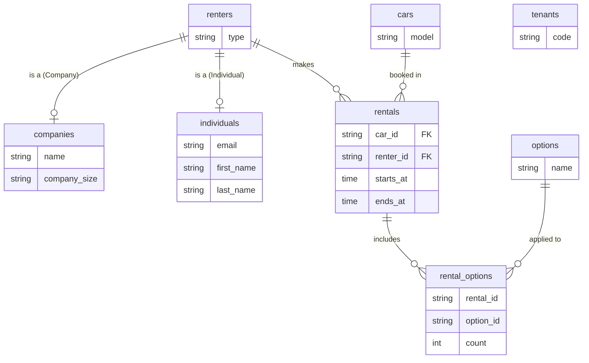
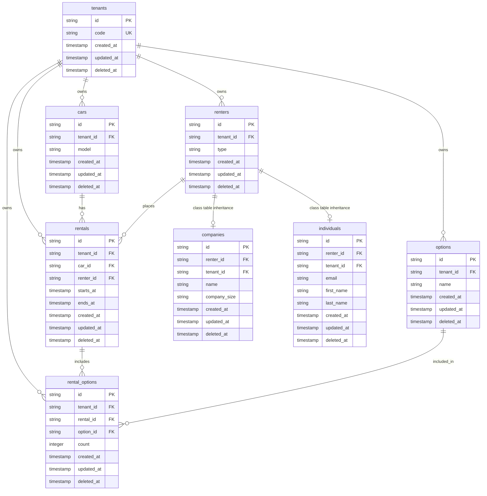

# ER Diagram

This system represents a SaaS platform for car rental companies.

Key characteristics of this system:

- **SaaS Platform**: Multi-tenant architecture where each tenant is a separate car rental company
- **Class Table Inheritance**: Renter is implemented using Class Table Inheritance pattern where Company and Individual are specialized types of Renter. Polymorphic Association was not used here because it breaks referential integrity — a `rentals.renter_id` column cannot have a proper foreign key constraint if it could point to either a `companies` row or an `individuals` row. Without that constraint, the database cannot prevent orphaned references, and queries become more complex (requiring type discriminators and conditional joins). CTI avoids this by keeping a single `renters` table as the stable FK target, while subtypes extend it in separate tables.
- **Many-to-Many Association**: Rental and Option entities are connected through the RentalOption entity, with a composite unique index applied to rental_id and option_id to ensure that the same option cannot be attached to a rental more than once

> **Note**: For simplicity, common columns such as `id`, `created_at`, and `updated_at` have been omitted from the diagram below. Additionally, the explicit associations with the Tenant entity have been removed, though in the actual implementation all entities are associated with a Tenant in a multi-tenant architecture.

# ER Diagram (Full Version)

